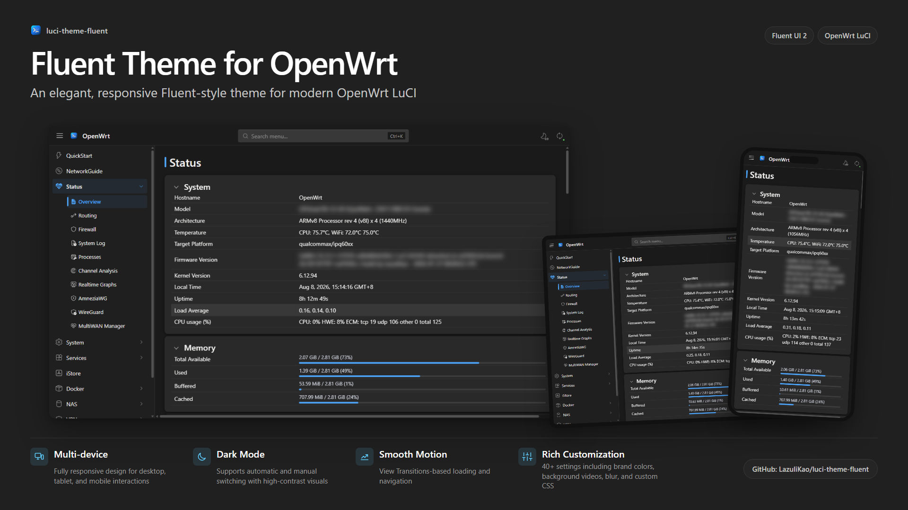
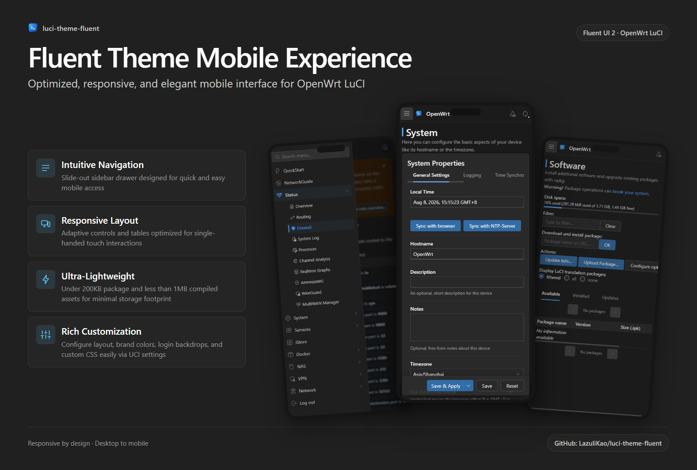
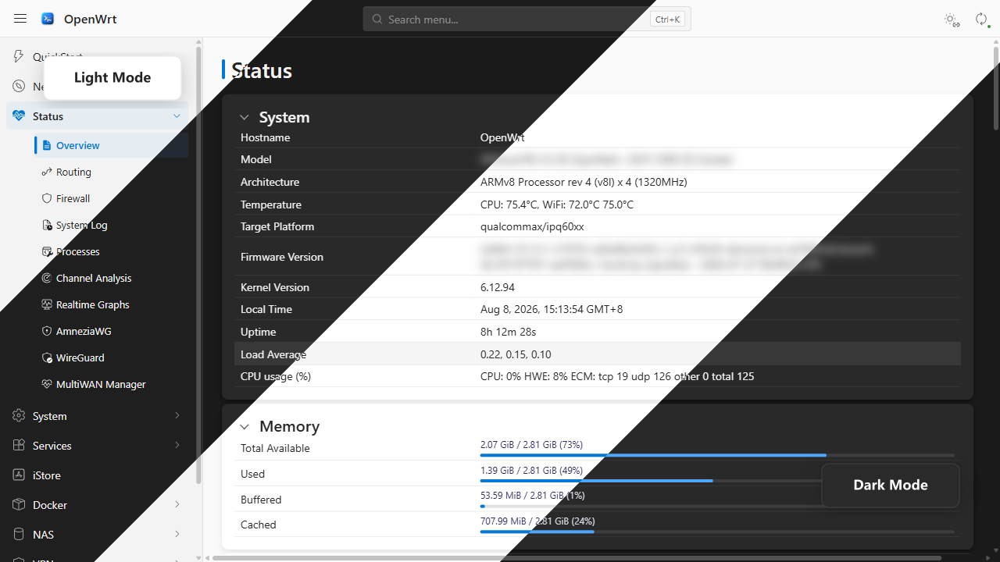
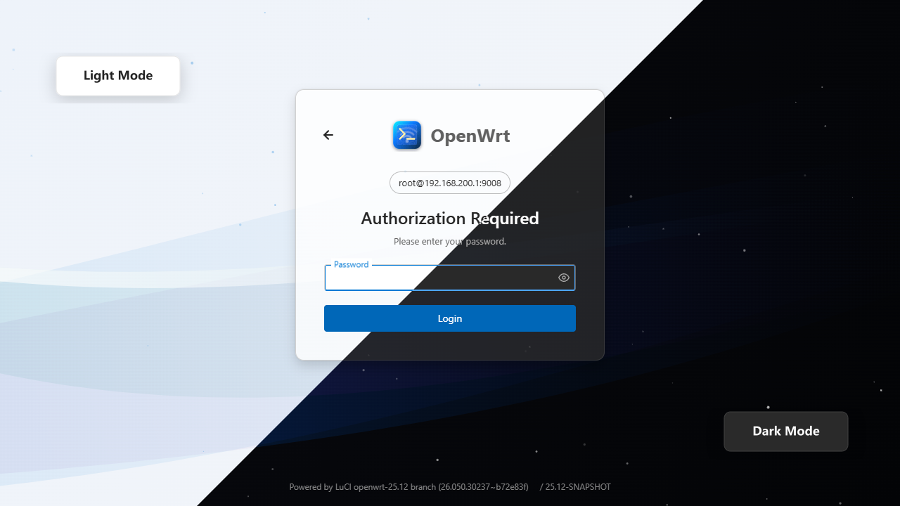

<div align="center">


# luci-theme-fluent (Canonical Edition)

A FluentUI-inspired OpenWrt LuCI theme built with Rsbuild using pure TypeScript/TSX, SCSS, Canonical v3.2 / v3.5.2 perceptual design tokens, and ucode templates.

[](./LICENSE)
[](https://forum.openwrt.org/t/luci-theme-fluent-fluent-theme-for-openwrt/251341)
[](./package.json)
[](https://openwrt.org/)
[](https://www.google.com/chrome/)
[](https://www.apple.com/safari/)
[](https://www.mozilla.org/firefox/)
[](https://github.com/LazuliKao/luci-theme-fluent/releases)
[](https://github.com/LazuliKao/luci-theme-fluent/releases)

**English** | [简体中文](./README.zh-Hans.md)

[Features](#key-features) • [Showcase](#showcase) • [Getting Started](#getting-started) • [Configuration](#configuration) • [Development](#development) • [Credits](#credits)
</div>

## Showcase

<p align="center">
  
</p>

<p align="center">
  
</p>

<p align="center">
  
</p>

<p align="center">
  
</p>

## Key Features

- Canonical v3.2 / v3.5.2 perceptual OKLCH + sRGB dual-layer token system on FluentUI 2 geometry.
- Dual-layer ambient + contact shadows, tactile micro-interactions, and WCAG AA / APCA contrast-safe semantic triads.
- Two theme variants: `luci-theme-fluent` (full feature set) and `luci-theme-fluent-lite` (ROM-friendly gzipped `fluent.css.gz` with `sessionStorage` instant caching; requires `DecompressionStream` support: Chrome >= 80, Firefox >= 113, Safari >= 16.4).
- ucode templates for LuCI header, footer, and login pages compatible with OpenWrt 24.10 (`opkg`) and OpenWrt 25.12.6 (`apk`).
- Theme settings UI for colors, animation, layout geometry, and login appearance, plus verified background updater.
- Structured overrides for plugin-specific OpenWrt pages and optional standalone `luci-mod-fluentdashboard`.

## Getting Started

### Quick Install

Auto-detects `apk` / `opkg` and `uclient-fetch` / `wget` / `curl`, installing the latest release by default:

```bash
wget -qO- https://raw.githubusercontent.com/LazuliKao/luci-theme-fluent/main/install.sh | sh
```

Install the `lite` variant or `nightly` channel:

```bash
# Latest lite variant
wget -qO- https://raw.githubusercontent.com/LazuliKao/luci-theme-fluent/main/install.sh | sh -s latest lite

# Nightly full variant
wget -qO- https://raw.githubusercontent.com/LazuliKao/luci-theme-fluent/main/install.sh | sh -s nightly full
```

After installation, navigate to `System -> Fluent Theme` in the LuCI web interface.

### Manual Installation

1. Open the release page and download the package file matching your system:
   - Stable releases: <https://github.com/LazuliKao/luci-theme-fluent/releases>
   - Nightly release: <https://github.com/LazuliKao/luci-theme-fluent/releases/tag/nightly>
2. Upload the downloaded file to your router, for example into `/tmp/`.
3. Install it with the matching package manager:

```bash
# OpenWrt 24.10.x (opkg)
opkg install /tmp/luci-theme-fluent_*.ipk

# OpenWrt 25.12.6+ (apk)
apk add --allow-untrusted --upgrade /tmp/luci-theme-fluent-*.apk
```

### Install from an OpenWrt source tree

You can add `luci-theme-fluent` (or `luci-theme-fluent-lite`) to your OpenWrt build system in one of two ways:

#### Option 1: Clone the repository and copy the package directory

```bash
cd openwrt
git clone --depth=1 https://github.com/LazuliKao/luci-theme-fluent.git /tmp/luci-theme-fluent
# OpenWrt expects package directories under `package/`.
cp -a /tmp/luci-theme-fluent/package/luci-theme-fluent package/
# Optional: also copy luci-theme-fluent-lite if building the lite variant
cp -a /tmp/luci-theme-fluent/package/luci-theme-fluent-lite package/
```

#### Option 2: Add to feeds

Add the following line to your `feeds.conf.default`:

```text
src-git fluent https://github.com/LazuliKao/luci-theme-fluent.git
```

Then update and install the feed:

```bash
./scripts/feeds update fluent
./scripts/feeds install -a -p fluent
```

After adding the package, configure and select it in `menuconfig`:

```bash
make menuconfig
```

Choose `LuCI -> Themes -> luci-theme-fluent` (or `luci-theme-fluent-lite`), then build your firmware or package as usual.

### Fluent Dashboard

`luci-mod-fluentdashboard` is an optional fixed-card status dashboard for OpenWrt 24.10 and 25.12.6. It uses its own `admin/fluentdashboard` route and works with any LuCI theme. It can be installed alongside the official `luci-mod-dashboard` package.

```bash
# OpenWrt 24.10.x
opkg install /tmp/luci-mod-fluentdashboard_*.ipk

# OpenWrt 25.12.6+
apk add --allow-untrusted --upgrade /tmp/luci-mod-fluentdashboard-*.apk
```

## Configuration

The theme exposes a LuCI settings page (`System -> Fluent Theme`) for:

- color mode (light / dark / auto) & Canonical brand colors
- layout geometry, card elevation, and motion preferences
- sidebar menu customization & UCI change preview
- login page wallpaper / blur appearance & verified online update

The settings view is implemented in `src/web/resources/view/fluent-config.tsx`.

## Development

### Install dependencies

Run this once from the repository root:

```bash
pnpm install
```

### Common commands

Run these commands from the repository root:

```bash
# Build full + lite CSS/gzipped CSS and LuCI JavaScript/TSX assets.
pnpm run build
# Watch source files and rebuild assets on changes.
pnpm run watch
# Watch and hot-sync standalone dashboard to a remote OpenWrt router.
pnpm run dev:dashboard:remote
# Run Biome lint on the package web assets and LuCI resources.
pnpm run lint
# Type-check the TypeScript project in `src`.
pnpm run typecheck
# Run unit tests.
pnpm test
# Extract and build translations; requires `OPENAI_API_KEY` in `.env`.
pnpm run i18n:build
# Extract the standalone dashboard translation catalog.
pnpm run i18n:dashboard
```

### Output paths

- Full CSS: `package/luci-theme-fluent/htdocs/luci-static/fluent/css/fluent.css`
- Lite CSS: `package/luci-theme-fluent-lite/htdocs/luci-static/fluent/css/fluent.css.gz`
- JS: `package/luci-theme-fluent/htdocs/luci-static/resources/` & `package/luci-theme-fluent-lite/htdocs/luci-static/resources/`
- Dashboard: `package/luci-mod-fluentdashboard/htdocs/luci-static/resources/view/fluentdashboard/`

## Credits

- [Upstream luci-theme-fluent](https://github.com/LazuliKao/luci-theme-fluent)
- [Microsoft Fluent Design](https://developer.microsoft.com/en-us/fluentui)
- [LuCI documentation](https://openwrt.org/docs/techref/luci)
- [ucode template language](https://openwrt.org/docs/techref/utpl)
- [Apache License 2.0](./LICENSE)
