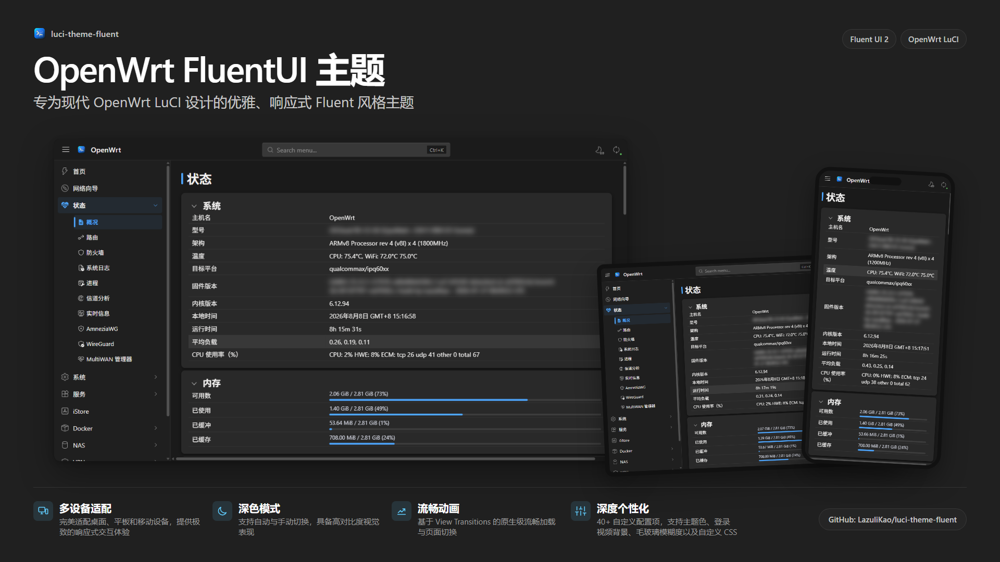
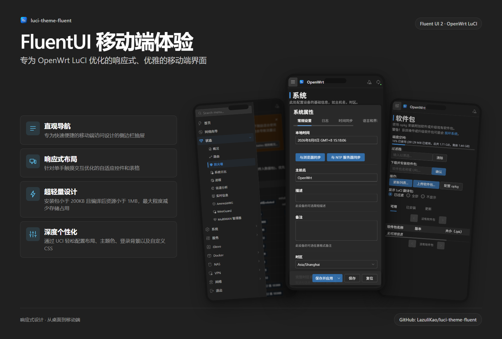
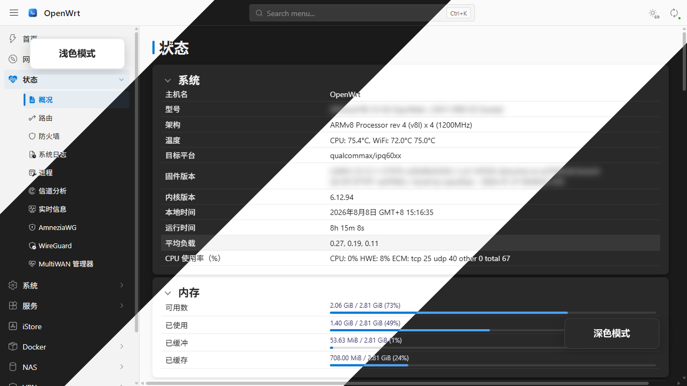
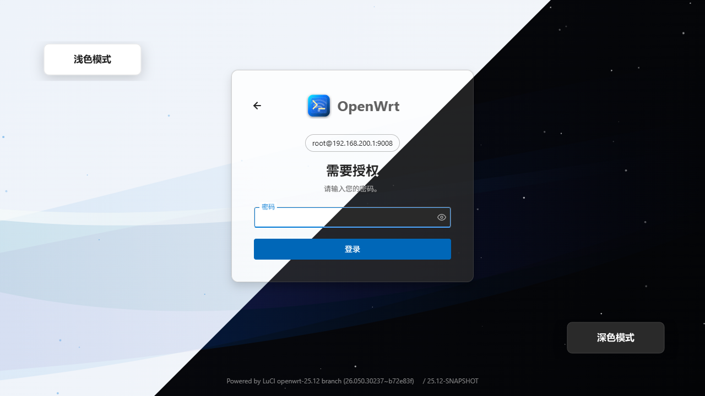

<div align="center">


# luci-theme-fluent (Canonical Edition)

一款基于 FluentUI 2 几何架构与 Canonical v3.2 / v3.5.2 感知色彩系统的 OpenWrt LuCI 主题，使用 Rsbuild、纯 TypeScript/TSX、SCSS 与 ucode 模板构建。

[](./LICENSE)
[](https://forum.openwrt.org/t/luci-theme-fluent-fluent-theme-for-openwrt/251341)
[](./package.json)
[](https://openwrt.org/)
[](https://www.google.com/chrome/)
[](https://www.apple.com/safari/)
[](https://www.mozilla.org/firefox/)
[](https://github.com/LazuliKao/luci-theme-fluent/releases)
[](https://github.com/LazuliKao/luci-theme-fluent/releases)

**简体中文** | [English](./README.md)

[功能特性](#功能特性) • [界面预览](#界面预览) • [快速上手](#快速上手) • [配置](#配置) • [开发指南](#开发指南) • [致谢](#致谢)
</div>

## 界面预览

<p align="center">
  
</p>

<p align="center">
  
</p>

<p align="center">
  
</p>

<p align="center">
  
</p>

## 功能特性

- 基于 Canonical v3.2 / v3.5.2 三层感知色彩契约（OKLCH 渐进增强 + sRGB 基线），全状态满足 WCAG AA / APCA 对比度门禁。
- 双层接触 + 环境光阴影体系、微交互阻尼物理曲线与等宽数字（`tabular-nums`）指标对齐。
- 提供双版本构建：`luci-theme-fluent`（完整版）与 `luci-theme-fluent-lite`（小闪存精简版，采用 `fluent.css.gz` 高压缩样式与 `sessionStorage` 零闪烁缓存；需浏览器支持 `DecompressionStream`，即 Chrome >= 80、Firefox >= 113、Safari >= 16.4）。
- 完整适配 OpenWrt 24.10（`opkg`）与 OpenWrt 25.12.6（`apk`），遵循 LuCI RPCD 最小读写权限契约。
- 内置主题设置面板（颜色模式、布局圆角、菜单编辑、UCI 变更预览、登录页毛玻璃壁纸及带结果校验的后台在线更新）。
- 提供可选且不依赖主题的 `luci-mod-fluentdashboard` 独立状态概览模块。

## 快速上手

### 一键安装

脚本会自动检测 `apk` / `opkg` 以及 `uclient-fetch` / `wget` / `curl`，默认安装最新正式版：

```bash
wget -qO- https://raw.githubusercontent.com/LazuliKao/luci-theme-fluent/main/install.sh | sh
```

安装精简版（`lite`）或每日构建版（`nightly`）：

```bash
# 安装最新正式版 lite
wget -qO- https://raw.githubusercontent.com/LazuliKao/luci-theme-fluent/main/install.sh | sh -s latest lite

# 安装每日构建完整版
wget -qO- https://raw.githubusercontent.com/LazuliKao/luci-theme-fluent/main/install.sh | sh -s nightly full
```

安装完成后，在 LuCI 界面中进入 `系统 -> Fluent 主题` 即可配置。

### 手动安装

1. 打开发布页面，下载与你的系统匹配的软件包：
   - 正式版：<https://github.com/LazuliKao/luci-theme-fluent/releases>
   - 每日构建版：<https://github.com/LazuliKao/luci-theme-fluent/releases/tag/nightly>
2. 将下载的文件上传到路由器，例如 `/tmp/` 目录。
3. 使用对应的包管理器进行安装：

```bash
# OpenWrt 24.10.x (opkg)
opkg install /tmp/luci-theme-fluent_*.ipk

# OpenWrt 25.12.6+ (apk)
apk add --allow-untrusted --upgrade /tmp/luci-theme-fluent-*.apk
```

### 从 OpenWrt 源码树编译

你可以通过以下两种方式之一将本软件包添加到 OpenWrt 编译系统中：

#### 方法一：克隆仓库并复制软件包目录

```bash
cd openwrt
git clone --depth=1 https://github.com/LazuliKao/luci-theme-fluent.git /tmp/luci-theme-fluent
# OpenWrt 要求软件包目录直接位于 `package/` 下。
cp -a /tmp/luci-theme-fluent/package/luci-theme-fluent package/
# 如需编译精简版，请同时复制 luci-theme-fluent-lite（其构建依赖主包模板与资源）：
cp -a /tmp/luci-theme-fluent/package/luci-theme-fluent-lite package/
```

#### 方法二：添加到 feeds

在 `feeds.conf.default` 中添加以下行：

```text
src-git fluent https://github.com/LazuliKao/luci-theme-fluent.git
```

然后更新并安装 feed：

```bash
./scripts/feeds update fluent
./scripts/feeds install -a -p fluent
```

添加软件包后，在 `menuconfig` 中选择 `LuCI -> Themes -> luci-theme-fluent`（或 `luci-theme-fluent-lite`），然后像往常一样构建固件或软件包即可。

### Fluent 状态概览

`luci-mod-fluentdashboard` 是适用于 OpenWrt 24.10 和 25.12.6 的可选固定卡片式状态概览。它使用独立的 `admin/fluentdashboard` 路由，可配合任意 LuCI 主题使用，也可以与官方 `luci-mod-dashboard` 同时安装。

```bash
# OpenWrt 24.10.x
opkg install /tmp/luci-mod-fluentdashboard_*.ipk

# OpenWrt 25.12.6+
apk add --allow-untrusted --upgrade /tmp/luci-mod-fluentdashboard-*.apk
```

## 配置

主题提供了 LuCI 设置页面（`系统 -> Fluent 主题`），支持配置以下内容：

- 颜色模式（浅色 / 深色 / 自动）与 Canonical 主题色
- 控件高度、圆角半径、卡片层级阴影与动效开关
- 侧边栏导航排序/隐藏与 UCI 变更预览
- 登录页毛玻璃壁纸外观与后台校验式在线升级

设置界面实现位于 `src/web/resources/view/fluent-config.tsx`。

## 开发指南

### 安装依赖

在仓库根目录执行一次：

```bash
pnpm install
```

### 常用命令

以下命令均应在仓库根目录执行：

```bash
# 构建完整版与精简版 CSS/gzipped CSS 以及 LuCI JavaScript/TSX 资源。
pnpm run build
# 监听源码变化并自动重新构建资源。
pnpm run watch
# 监听并将独立状态概览热同步至远程 OpenWrt 路由器。
pnpm run dev:dashboard:remote
# 使用 Biome 检查代码规范。
pnpm run lint
# 对 `src` 中的 TypeScript 项目执行类型检查。
pnpm run typecheck
# 运行单元测试。
pnpm test
# 提取并构建翻译；需要在 `.env` 中设置 `OPENAI_API_KEY`。
pnpm run i18n:build
# 提取独立状态概览的翻译目录。
pnpm run i18n:dashboard
```

### 输出路径

- 完整版 CSS：`package/luci-theme-fluent/htdocs/luci-static/fluent/css/fluent.css`
- 精简版 CSS：`package/luci-theme-fluent-lite/htdocs/luci-static/fluent/css/fluent.css.gz`
- JS：`package/luci-theme-fluent/htdocs/luci-static/resources/` 与 `package/luci-theme-fluent-lite/htdocs/luci-static/resources/`
- 状态概览：`package/luci-mod-fluentdashboard/htdocs/luci-static/resources/view/fluentdashboard/`

## 致谢

- [上游仓库 LazuliKao/luci-theme-fluent](https://github.com/LazuliKao/luci-theme-fluent)
- [Microsoft Fluent Design](https://developer.microsoft.com/en-us/fluentui)
- [LuCI 文档](https://openwrt.org/docs/techref/luci)
- [ucode 模板语言](https://openwrt.org/docs/techref/utpl)
- [Apache License 2.0](./LICENSE)
